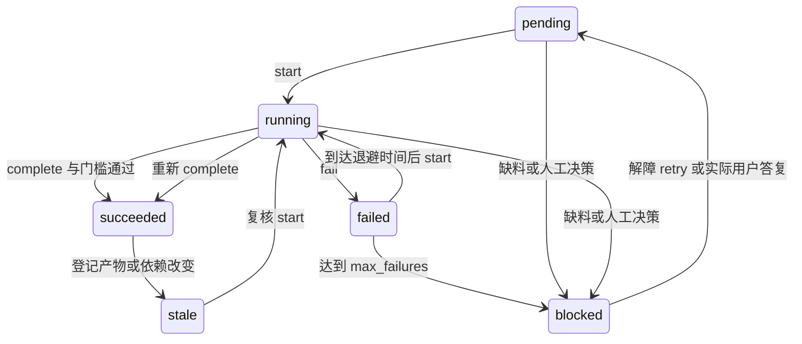

# v3 执行接口

当前 Codex 连续执行调度器返回的任务。命令负责确定性计算、记录和验收；next 不会自行启动模型。先从技能 runtime.json 取解释器，v3 需要 jsonschema。以下分别是解释器、技能路径、用户指定项目路径；目录带空格必须加引号。

```bash
WORKBENCH_PYTHON='python3'
WORKBENCH_SKILL='/absolute/path/vibe-research'
WORKBENCH_PROJECT='/absolute/path/research-project'
```

## 编排与恢复

新项目默认 structured，增加 schema 和质量门槛；已有 legacy 项目按原 profile 恢复，不静默当作已迁移。初始化不覆盖已有流水线。对于有 engine-manifest 的 structured 项目，start/complete/fail/block/retry 先核对实际执行 scripts/schemas 的 SHA 与冻结清单；不同版本拒绝变更并提示使用项目 runtime-snapshot/scripts。next/status 仍可查看失效；没有快照的旧项目保留未冻结限制。

```bash
"$WORKBENCH_PYTHON" "$WORKBENCH_SKILL/scripts/pipeline.py" init --project "$WORKBENCH_PROJECT" --topic '研究主题'
# structured init 后采用冻结运行版本；legacy 项目无快照时保留原技能路径
WORKBENCH_SKILL="$WORKBENCH_PROJECT/runtime-snapshot"
"$WORKBENCH_PYTHON" "$WORKBENCH_SKILL/scripts/pipeline.py" next --project "$WORKBENCH_PROJECT"
"$WORKBENCH_PYTHON" "$WORKBENCH_SKILL/scripts/pipeline.py" start --project "$WORKBENCH_PROJECT" --stage scope
# 实际完成 question.md 和 project-spec.json 后登记
"$WORKBENCH_PYTHON" "$WORKBENCH_SKILL/scripts/pipeline.py" complete --project "$WORKBENCH_PROJECT" --stage scope
```

next 的 stage-task 包含 stage/status/runnable/dependencies/skills/required_artifacts/inputs/reason/action/retry/human_decision_ids。只接受最早未完成阶段的操作。



调度器允许内容准备完成后直接 complete；仍建议 start 留下开始时间。默认 pipeline-policy.json 为 max_failures=3、backoff_seconds=1、max_backoff_seconds=30。第 n 次实际失败且未达上限时，等待 min(max_backoff_seconds, backoff_seconds * 2^(n-1))；实际重试动作由当前 Codex 执行。

```bash
"$WORKBENCH_PYTHON" "$WORKBENCH_SKILL/scripts/pipeline.py" fail --project "$WORKBENCH_PROJECT" --stage read --reason '替代全文来源也请求失败'
"$WORKBENCH_PYTHON" "$WORKBENCH_SKILL/scripts/pipeline.py" block --project "$WORKBENCH_PROJECT" --stage read --reason '缺少能支持核心论断的授权原文'
"$WORKBENCH_PYTHON" "$WORKBENCH_SKILL/scripts/pipeline.py" retry --project "$WORKBENCH_PROJECT" --stage read --reason '已经取得授权全文'
```

schema、数据或代码错误先修复，不反复执行同一坏输入。retry 只用于 failed/blocked，需实际解障依据；未答复人工决定仍阻止重试。修改前置产物后，从最早 stale 阶段重新核验，再重做后续门槛。

## 检索、筛选和全文

先按 search-query 写 research/search-query.json。筛选参数文件是 screening.criteria 对象，含 include_terms/exclude_terms/year_min/year_max/require_abstract。

```bash
"$WORKBENCH_PYTHON" "$WORKBENCH_SKILL/scripts/collect_sources.py" search --project "$WORKBENCH_PROJECT" --request "$WORKBENCH_PROJECT/research/search-query.json" --max-attempts 3
"$WORKBENCH_PYTHON" "$WORKBENCH_SKILL/scripts/screen_sources.py" run --project "$WORKBENCH_PROJECT" --criteria research/screening-criteria.json
"$WORKBENCH_PYTHON" "$WORKBENCH_SKILL/scripts/screen_sources.py" adjudicate --project "$WORKBENCH_PROJECT" --source-id SOURCE_ID --decision include --reason '已核对正文满足纳排标准' --reviewer 'current-codex-session'
"$WORKBENCH_PYTHON" "$WORKBENCH_SKILL/scripts/collect_sources.py" capture --project "$WORKBENCH_PROJECT" --source-id SOURCE_ID --input /absolute/path/extracted-text.txt
```

初筛已有记录时拒绝覆盖，不得未经复核用 --force 抹去改判。近似重复只列 possible_duplicates，精确重复题录保留并标排除。capture 只登记文本和 SHA；实际读后才能登记全文访问、阅读范围和论断核验。

search 管候选、请求/响应和筛选；read 管 sources/evidence/reading-notes。补全文不改写已完成检索快照；原文新版本另用来源 ID。证据来源须已在 screening 纳入，排除/未决来源不得直接作为已核验报告证据。

## 模型任务回执

按 model-request 写本阶段请求，response_schema 使用本地 schema 内容，input_files 写项目相对路径与 SHA，parameters.artifact_path 写本次结构化产物路径。配置为 {"backend":"codex","project":"项目绝对路径"}；未知实际模型版本记录 current-codex-session。详细协议见 [interfaces.md](interfaces.md)。

```bash
"$WORKBENCH_PYTHON" "$WORKBENCH_SKILL/scripts/model_backends.py" generate --config /absolute/path/backend-config.json --request /absolute/path/task-request.json
# 返回 needs_execution 后，当前 Codex 实际执行任务并写输出对象
"$WORKBENCH_PYTHON" "$WORKBENCH_SKILL/scripts/model_backends.py" accept-codex --project "$WORKBENCH_PROJECT" --request /absolute/path/task-request.json --output /absolute/path/actual-output.json
```

model-io/ID.request.json 和 ID.response.json 保留请求和完成回执；同一 ID 不允许写不同请求或不同完成输出，重做用新 ID。阶段回执与当前输入 SHA、结构化产物内容须一致。未知模型/usage 不猜测或填 0。command 只执行显式配置的 argv，shell=False，是扩展点，不等于已连接外部模型。

## 数据、报告、质量

先明确研究设计，再按 dataset-spec 写数据字典。当前自动数值适配器处理项目内 CSV；选择方法见 [data-and-quality.md](data-and-quality.md)。

```bash
"$WORKBENCH_PYTHON" "$WORKBENCH_SKILL/scripts/analyze_data.py" --project "$WORKBENCH_PROJECT" --spec data/dataset-spec.json --outcome OUTCOME --predictors PREDICTOR1 PREDICTOR2
"$WORKBENCH_PYTHON" "$WORKBENCH_SKILL/scripts/pipeline.py" complete --project "$WORKBENCH_PROJECT" --stage analyze
```

executed 保存原始数据和字典冻结副本、data/cleaned.csv、cleaning-log.json、环境、analysis-code/reproduce.py、复现输出和 analysis-result。standalone 复现代码不依赖 skill 路径。另选统计或访谈方法也须符合 analysis-result 并提供实际执行证据；当前 OLS 复现评估不会自动支持新方法。

无数据写 planned 的 JSON/Markdown 和同一原因后：

```bash
"$WORKBENCH_PYTHON" "$WORKBENCH_SKILL/scripts/pipeline.py" complete --project "$WORKBENCH_PROJECT" --stage analyze --disposition planned --reason '尚未采集实测数据'
```

按 research-report 写 report.json，从 stage_contracts.render_report(Path(PROJECT)) 渲染 report.md。支持性论断须链接已核验全文证据或 executed 分析；假设独立标记。

```bash
"$WORKBENCH_PYTHON" "$WORKBENCH_SKILL/scripts/quality.py" --project "$WORKBENCH_PROJECT"
"$WORKBENCH_PYTHON" "$WORKBENCH_SKILL/scripts/pipeline.py" complete --project "$WORKBENCH_PROJECT" --stage review
"$WORKBENCH_PYTHON" "$WORKBENCH_SKILL/scripts/workspace.py" check --project "$WORKBENCH_PROJECT"
"$WORKBENCH_PYTHON" "$WORKBENCH_SKILL/scripts/pipeline.py" status --project "$WORKBENCH_PROJECT"
"$WORKBENCH_PYTHON" "$WORKBENCH_SKILL/scripts/export_bundle.py" --project "$WORKBENCH_PROJECT"
```

quality 使用固定必需产物清单，缺失不会从分母消失。自定义输入可以使用 quality.py --project PROJECT --policy review/custom-policy.json --benchmark review/benchmark.json，路径限项目内。quality-report 保存 evaluation_config 的实际策略/独立标签路径，以及 evaluation_inputs 中每个科学输入的 SHA；标注集须独立，默认无标签仍为 not_measured。review complete 按 quality-report 的 evaluation_config 重算，核对 metrics/policy SHA 与 evaluation_inputs 收据；配置过独立 benchmark 时不能改用默认未测报告。通过仍需实际学术审查。

## 人工交接与追溯

真实材料无法替代、研究方向实质改变、缺失实际授权时交接。普通初筛改判可由 Codex 审阅并记录 reviewer；不能把自动判断标作用户答复。

```bash
"$WORKBENCH_PYTHON" "$WORKBENCH_SKILL/scripts/human_decisions.py" request --project "$WORKBENCH_PROJECT" --stage design --question '需要选择哪个已确认可实施的采样范围？' --options '范围 A' '范围 B'
# 仅收到真实用户回答后，记录原回答
"$WORKBENCH_PYTHON" "$WORKBENCH_SKILL/scripts/human_decisions.py" answer --project "$WORKBENCH_PROJECT" --id DECISION_ID --text '实际用户答复' --actor 'user'
```

structured init 冻结本次脚本和 schemas 到 runtime-snapshot，engine-manifest.json 登记文件 SHA 和 Python/库版本。项目可按冻结版本复查，不能仅凭当前安装目录推定旧版本行为相同。

pipeline-state.json 保存状态和输入/输出/追踪文件哈希，events.jsonl 保存顺序事件。项目锁与原子状态替换防并发写入；状态/日志序号不一致直接报错。SHA 是变化检测，不是防恶意重写的数字签名。交付包选显式白名单，并按 analysis-result/quality-report 的精确收据纳入项目内数据、外置策略和独立标注集；manifest 保存载荷大小和 SHA。本地保存不代表获得公开许可。
